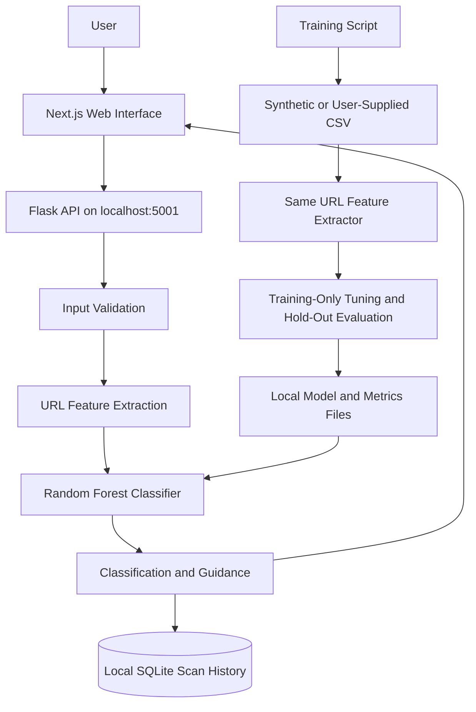

# PhishGuard

**Local phishing-URL classification using a Random Forest model.**

PhishGuard is a full-stack web application for examining URL strings and classifying them as **Safe**, **Suspicious**, or **Phishing** using URL structure and lexical features. It combines a Next.js interface with a Flask API, a locally trained scikit-learn Random Forest classifier, and SQLite scan history.

> **Important limitation:** PhishGuard currently analyses the URL string only. It does not visit the website, inspect page content, resolve DNS, validate TLS certificates, query a live threat-intelligence feed, or block a browser request. A “Safe” result is not a guarantee that a URL is safe. Treat results as an educational screening signal, not a security verdict.

## Features

- **Single URL analysis** with a three-level classification, score, extracted features, and user guidance.
- **Bulk classification** from CSV or TXT files (up to 500 URL rows per request; uploaded request size is capped at 1 MiB).
- **Local scan history** stored in SQLite, with search, sorting, and pagination.
- **Dashboard summaries** for the local scan history.
- **Model evaluation view** showing hold-out metrics, cross-validation summary, feature importances, and labelled-scan confusion-matrix data.
- **Postman collection** for exercising the HTTP API.

## Screenshots

Screenshots are not included in this repository yet. Add genuine application screenshots to `docs/screenshots/` after running the application locally; do not use mock UI images or sample values as evidence of real scans.

## Architecture



## Technology stack

| Layer | Technologies |
|---|---|
| Frontend | Next.js App Router, React, TypeScript, Tailwind CSS |
| UI and charts | Framer Motion, Recharts, Lucide React, SWR |
| Backend | Python, Flask, Flask-CORS, Flask-Limiter |
| Data and model | SQLite, pandas, NumPy, scikit-learn |
| API testing | Postman |

The frontend dependency manifest currently specifies Next.js **16.2.9** and React **19.2.4**. Use a supported Node.js release (20.9 or newer) and check the package manifest if you change dependency versions.

## Requirements

- Python 3.10 or newer (Python 3.11 is a sensible development baseline).
- Node.js 20.9 or newer and npm.
- Git.

Node.js binaries and Python virtual environments are not bundled with this repository.

## Run locally

PhishGuard is intended for local development. The Flask API binds to `127.0.0.1:5001`; the Next.js development server uses port `3000`.

### Windows — recommended first run

1. Install [Python 3.11](https://www.python.org/downloads/) and [Node.js 20.9 or newer](https://nodejs.org/). Make sure npm is included with the Node.js installer and Python is available from the Windows Python Launcher (`py`) or PATH.
2. Download the repository ZIP and extract the complete folder. Do not run the batch files from inside the ZIP preview.
3. Double-click `run_phishguard.bat`.
4. The launcher opens separate Backend and Frontend windows. On the first run, the backend launcher creates `backend/venv`, installs the packages from `backend/requirements.txt`, and trains a local Random Forest model if compatible model artifacts are missing. The frontend launcher installs the exact locked packages using `npm ci` if `frontend/node_modules/next` is missing.
5. The main launcher checks the backend health endpoint and the frontend page, then opens [http://localhost:3000](http://localhost:3000).

The first run requires an internet connection for package installation and can take several minutes while dependencies and the model are prepared. Keep both service windows open while using PhishGuard. Close those windows or press Ctrl+C in each to stop the services. Subsequent starts reuse the virtual environment, npm packages and compatible model artifacts.

You can also run `run_backend.bat` or `run_frontend.bat` separately. Each script checks its runtime and installs its own missing project dependencies before starting.

### 1. Clone the repository

```bash
git clone https://github.com/bsathwik-cyber/Phishing-Website-Detection.git
cd Phishing-Website-Detection
```

### 2. Manual backend setup

Windows PowerShell:

```powershell
cd backend
py -3.11 -m venv venv
.\venv\Scripts\Activate.ps1
python -m pip install --upgrade pip
pip install -r requirements.txt
python train_model.py
python app.py
```

macOS / Linux:

```bash
cd backend
python3 -m venv venv
source venv/bin/activate
python -m pip install --upgrade pip
pip install -r requirements.txt
python train_model.py
python app.py
```

The Flask API listens at `http://127.0.0.1:5001`.

### 3. Manual frontend setup

Open a second terminal:

```bash
cd frontend
npm ci
npm run dev
```

Open [http://localhost:3000](http://localhost:3000).

Node.js binaries and Python virtual environments are not bundled with this repository. If a manual `npm run dev` reports that `next` is not recognised, run `npm ci` from the `frontend/` directory first. If the backend launcher reports that its virtual environment is missing, rerun `run_backend.bat` from the project root; it creates and installs that environment automatically.

Training writes local artifacts to `backend/model/` and generates `backend/dataset.csv` when no dataset is supplied. These files are ignored by Git.

## Training data and evaluation

The default dataset generator creates **synthetic URL examples** from hard-coded domain, path, keyword, and URL-pattern lists. The generator uses a fixed random seed and sorted de-duplication to make its output repeatable.

Synthetic data is useful for exercising the application pipeline, but it is not a representative sample of live phishing activity. Metrics calculated from it should not be presented as real-world detection performance. The model score is not calibrated as a probability of maliciousness.

For an independent experiment, provide a properly licensed and documented CSV at `backend/dataset.csv` with these columns:

| Column | Meaning |
|---|---|
| `url` | URL string to analyse |
| `label` | `0` for legitimate, `1` for phishing |

The training script validates the required columns and binary labels, performs a stratified hold-out split, selects hyperparameters using cross-validation within the training partition, and evaluates the selected model once on the held-out test partition. It does not insert test-set rows into normal user scan history.

When reporting results, document the dataset source, collection date, licence, class balance, split method, and limitations. Avoid relying on accuracy alone; inspect precision, recall, F1, and the confusion matrix.

## URL features

The feature extractor derives 15 URL-only attributes:

1. URL length
2. Hostname length
3. Dot count
4. Hyphen count
5. Digit count
6. Estimated subdomain count
7. HTTPS scheme indicator
8. IP-address hostname indicator
9. Suspicious keyword count
10. Selected special-character count
11. Redirect-related query/path indicator
12. Presence of `@`
13. Repeated slash indicator in the parsed path
14. Shannon entropy of the URL string
15. Hand-maintained TLD risk heuristic

These are engineering features, not proof of malicious activity. For example, HTTPS is not proof of trustworthiness, and a TLD risk table is only a coarse heuristic.

## API overview

Base URL: `http://127.0.0.1:5001`

| Method | Endpoint | Purpose |
|---|---|---|
| POST | `/api/predict` | Classify one URL |
| POST | `/api/bulk-predict` | Classify URLs in an uploaded CSV/TXT file |
| GET | `/api/history` | Search, sort, and paginate local scan history |
| GET | `/api/stats` | Retrieve history summary data |
| GET | `/api/model-metrics` | Retrieve training/evaluation metrics |
| GET | `/api/health` | Check local backend readiness and model availability |
| GET | `/api/dashboard/stats` | Retrieve dashboard summaries |
| GET | `/api/dashboard/feature-importance` | Retrieve Random Forest feature importances |
| GET | `/api/dashboard/confusion-matrix` | Calculate matrix from stored scans with supplied labels |

Example single-URL request:

```bash
curl -X POST http://127.0.0.1:5001/api/predict \
  -H "Content-Type: application/json" \
  -d '{"url":"https://example.com/login"}'
```

The Postman collection is available at `phishguard_postman_collection.json`.

## Local data and privacy

- Scan history is stored in `backend/phishguard.db` on the machine running the backend.
- URLs can contain personal, account, or internal information. Treat the database and exported CSV files as sensitive.
- The database, generated dataset, trained model, and generated metrics are excluded from version control.
- The current application has no user authentication or multi-user access control. Do not expose the Flask service to the public internet.
- The API accepts URL strings; the current implementation does not fetch or open the submitted websites.

See [SECURITY.md](SECURITY.md) for safe-use and disclosure guidance.

## Tests

From the repository root:

```bash
python -m unittest discover -s backend/tests -v
```

The test suite covers URL-feature extraction behavior. It does not replace manual end-to-end testing of the frontend, API, file uploads, or model training.

## Repository structure

```text
.
├── backend/
│   ├── app.py
│   ├── database.py
│   ├── feature_extractor.py
│   ├── generate_dataset.py
│   ├── requirements.txt
│   ├── train_model.py
│   └── tests/
├── frontend/
│   ├── src/
│   ├── package.json
│   └── package-lock.json
├── .github/workflows/
├── .gitignore
├── SECURITY.md
├── README.md
├── diagnostic.py
└── phishguard_postman_collection.json
```

## Current status

PhishGuard is a local educational prototype. It is not a production anti-phishing service, browser protection extension, threat-intelligence platform, or guarantee that a URL is safe.
